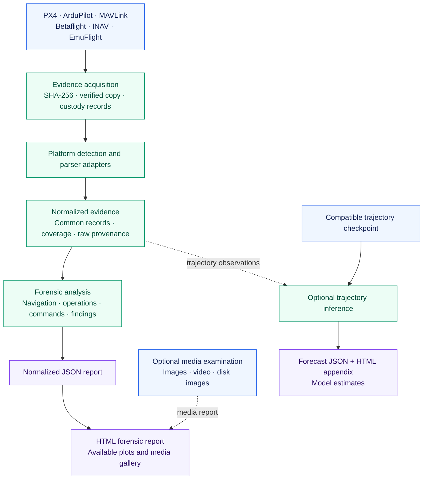
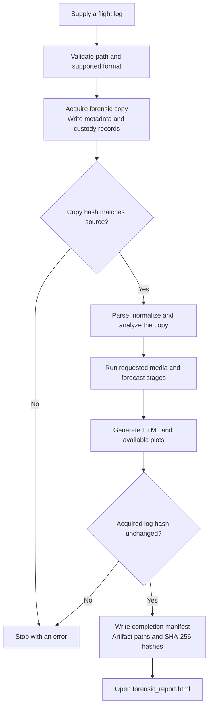
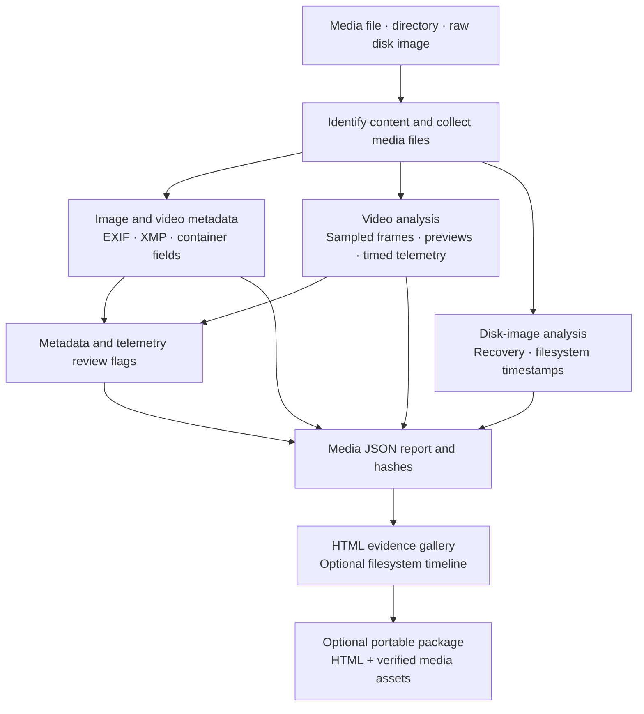
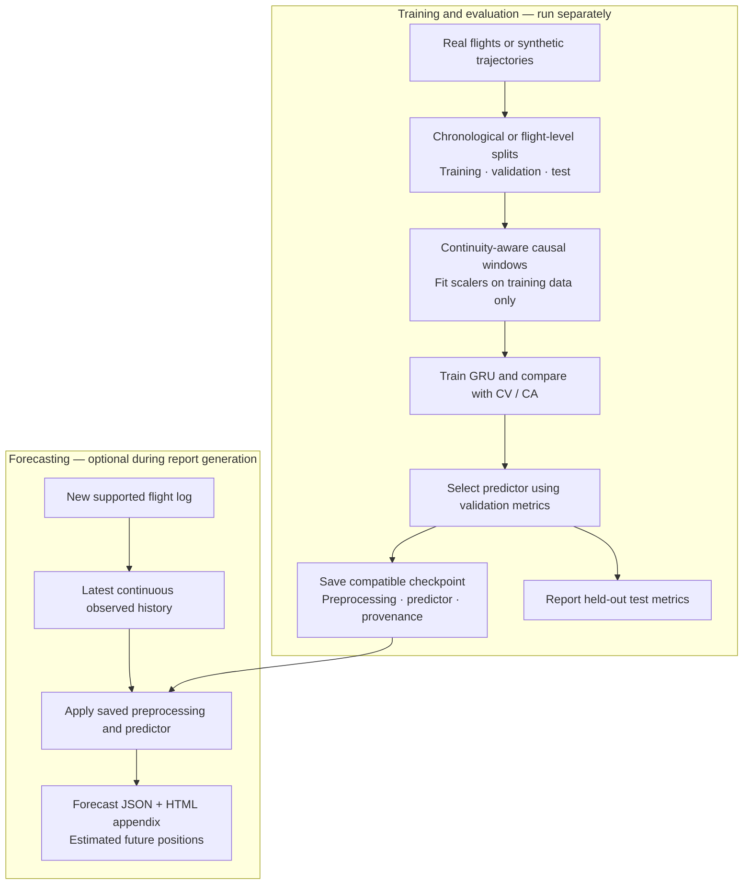

# Drone Forensics Toolkit

**Acquire drone evidence, reconstruct flight activity, and generate forensic reports across multiple flight-controller platforms.**

The toolkit converts flight logs into a shared evidence model for navigation,
battery, telemetry, commands, vehicle state, and security analysis. Optional
media examination and trajectory forecasting extend the investigation with
images, video, removable-storage artifacts, and model-generated estimates.

[Architecture](#architecture) · [Quick start](#quick-start) · [Usage](#usage) · [Supported formats](#supported-formats) · [Reports](#reports-and-outputs) · [Testing](#testing) · [Documentation](#documentation)

## Capabilities

- **Evidence preservation:** SHA-256 hashing, verified acquisition copies, metadata, and chain-of-custody records.
- **Multi-platform analysis:** automatic format detection and a common evidence representation across supported adapters.
- **Flight reconstruction:** available GPS, navigation, trajectory, commands, acknowledgements, states, parameters, and events.
- **Operational analysis:** recorded battery, communications, health, and failsafe information, with explicit coverage limits.
- **Media forensics:** image/video metadata, SRT sidecars, supported embedded telemetry, frame previews, and filesystem timelines.
- **Readable reporting:** normalized JSON, HTML reports, available plots, optional media galleries, and output hashes.
- **Trajectory forecasting:** saved-checkpoint inference using a GRU or physics baseline, with estimates kept separate from recorded evidence.

## Architecture

Platform adapters translate different log formats into a shared evidence model.
Analysis and reporting use this common representation; media examination and
checkpoint-based forecasting provide optional outputs.



## Quick start

Use Python 3.12, Git, and Git LFS. Run commands from the repository root.

```bash
git clone https://github.com/aeolusBPHC/Competition_IIT_Bombay_Techfest_Forensics.git
cd Competition_IIT_Bombay_Techfest_Forensics

git lfs install --local
git lfs pull

python3 -m venv .venv
source .venv/bin/activate
python3 -m pip install -r requirements.txt
```

Then process a supported flight log:

```bash
python3 -m cli.main process --input /path/to/flight.ulg
```

The command acquires and verifies the log, detects its format, runs normalized
analysis, generates JSON and HTML reports with available plots, rechecks the
acquired log's hash, and records the output hashes in a completion manifest.
The terminal prints the report location.



Other stage errors also stop processing. A completion manifest is written only
after every requested stage finishes.

Bundled logs, checkpoints, datasets, MP4s, and archives use Git LFS. Install Git
LFS before downloading them: a small LFS pointer file is not usable evidence or
a model. You can also supply your own supported log.

## Usage

### Choose a case and output folder

```bash
python3 -m cli.main process \
  --input /path/to/flight.ulg \
  --case CASE-005 \
  --output reports/CASE-005/run-01
```

The case identifier is optional and is generated when omitted. The output folder
must be new, protecting previous results from replacement. Without `--output`,
results are saved under `repository/cases/<case>/<evidence>/results/`.

### Include images, video, or a disk image

```bash
python3 -m cli.main process \
  --input /path/to/flight.ulg \
  --case CASE-005 \
  --media /path/to/card-extraction \
  --portable-media
```

`--media` accepts a directory, a media file, or a raw disk image. The HTML gallery
can display images, browser-playable video, metadata, hashes, and sampled frame
previews. `--portable-media` copies hash-verified media beside the report; keep
that assets folder with the HTML when sharing it.

Single media files and disk images receive acquisition copies and custody
records. Directories are examined in place with per-media-file hashes; this does
not acquire the whole directory. Recovered disk-image derivatives are retained
under the results folder.



Branches depend on the input type, recorded data, and installed tools. Media
timestamps retain their source clock basis; this flow does not align them with
the flight log automatically.

For optional media capabilities on Ubuntu/Debian:

```bash
sudo apt install ffmpeg libimage-exiftool-perl sleuthkit
```

| Tool | Enables |
| --- | --- |
| FFmpeg / ffprobe | Video frame indexing, JPEG previews, and GoPro GPMF decoding |
| ExifTool | Additional metadata and supported DJI embedded telemetry; `djmd` requires version 13.05+ |
| Sleuth Kit | Disk-image file recovery and filesystem timestamp extraction |

Unavailable tools and undecodable streams are reported in the media results.
See [MEDIA_EXTRACTOR.md](MEDIA_EXTRACTOR.md) for supported metadata, clock bases,
review thresholds, and recovery limitations.

### Add a trajectory forecast

Install PyTorch for CPU inference, then provide a checkpoint trained with the
current trajectory pipeline. A GPU is optional.

```bash
python3 -m pip install torch --index-url https://download.pytorch.org/whl/cpu
```

Run forecasting with the checkpoint's validation-selected predictor:

```bash
python3 -m cli.main process \
  --input /path/to/flight.ulg \
  --checkpoint /path/to/compatible-model.pt
```

The forecast is saved as a separate JSON result and HTML appendix. Reporting
uses the checkpoint's validation-selected GRU, constant-velocity, or
constant-acceleration predictor; it does not train a new model on each input.
Insufficient continuous history or an incompatible checkpoint fails the
requested forecast stage.

To explicitly run the neural-network predictor, generate a GRU appendix:

```bash
python3 -m cli.main trajectory-predict \
  --input /path/to/flight.ulg \
  --checkpoint /path/to/compatible-model.pt \
  --predictor gru \
  --output reports/ml/predictions.json \
  --report reports/ml/ml_report.html
```

Replace every `/path/to/...` example with an existing file. The checkpoint must
be compatible with the current feature contract; the historical bundled `.pt`
files are not interchangeable with current checkpoints. Forecasting and the
complete test suite require PyTorch, while core forensic reporting does not.

The training pipeline supports causal resampling, continuity-aware windows,
train-only scaling, flight-level splits, mission/platform holdouts, repeated
seeds, and provenance tracking. See [ml/README.md](ml/README.md) for training,
evaluation, and checkpoint migration. Older checkpoints require retraining.



Held-out test results measure performance; validation results choose the saved
predictor. Forecasting uses observed history and the saved checkpoint.

### Run stages individually

```bash
# Acquire and verify evidence.
python3 -m acquisition.acquire --input /path/to/flight.ulg --case CASE-005

# Detect, parse, and analyze a log to JSON.
python3 -m cli.main normalized-analysis \
  --input /path/to/flight.ulg --output reports/normalized_report.json

# Render the normalized analysis as HTML.
python3 -m reporting.normalized_report_generator \
  --input reports/normalized_report.json --output reports/forensic_report.html

# Examine media independently of a flight log.
python3 -m media.extractor \
  --input /path/to/media --output reports/media_report.json

# Show all end-to-end processing options.
python3 -m cli.main process --help
```

Use `process` for the complete workflow. The legacy `analyze`, `report`, and
`case` CLI commands do not provide the same end-to-end processing.

## Supported formats

| Platform / format | Evidence coverage |
| --- | --- |
| **PX4 ULog** | GPS, navigation, native trajectory, battery, telemetry, health, commands/ACKs, states, parameters, and events |
| **ArduPilot DataFlash** | GPS/GPS2, position, EKF trajectory/validity, battery/cells, radio, errors/recovery, commands, modes, parameters, and events |
| **ArduPilot TLOG** | MAVLink evidence with explicit ArduPilot platform attribution |
| **Generic MAVLink TLOG** | GPS/navigation, supported local/odometry trajectories, battery, telemetry, health, commands/ACKs, states, and parameters |
| **Betaflight Blackbox** | Recorded main/GPS/home/slow/event frames, configuration, and sensor/control observations |
| **INAV Blackbox** | Shared Blackbox evidence plus native navigation trajectories where recorded |
| **EmuFlight Blackbox** | Recorded Blackbox evidence, configuration, and supported unit conversions |

Coverage depends on firmware, enabled logging, recorded fields, and decoder
support. Reports retain raw observations and identify missing, unsupported, or
incompletely decoded evidence. Normalized metric trajectories use **ENU**:
x east, y north, z up.

See [platform_parsers/README.md](platform_parsers/README.md) for exact mappings
and field-level limitations. Encrypted DJI app flight records and arbitrary DJI
flight CSVs are not registered flight-log formats.

## Reports and outputs

| Artifact | Purpose |
| --- | --- |
| `metadata.json` | Acquisition source, identifiers, timestamps, and evidence hashes |
| `chain_of_custody.json` | Acquisition and integrity-verification events |
| `normalized_report.json` | Normalized evidence, coverage, analysis, provenance, and findings |
| `forensic_report.html` | Main readable report with available visualizations and linked media |
| `forensic_report_plots/` | Generated plots |
| `run_manifest.json` | Completion state, identifiers, artifact paths, and output hashes |
| `media_report.json` | Optional media metadata, telemetry, anomalies, and filesystem observations |
| `forensic_report_assets/` | Optional portable media copies |
| `trajectory_forecast.json` / `.html` | Optional forecast and appendix |

Acquisition metadata and custody records are stored beside the acquired evidence;
analysis and report artifacts go in the results folder. Normalized/media JSON,
the main HTML, and the completion manifest have SHA-256 sidecars.

A failed run exits nonzero and retains partial outputs for inspection. The
completion manifest is written only after all requested stages finish. The HTML
renderer can still produce a report when individual plots are unavailable and
records that limitation in the report.

## Interpreting results

- Missing fields remain unavailable; the toolkit does not invent evidence or assume unknown units.
- A healthy status record is not an active failsafe; inspect the recorded values and active-failure counts.
- Linking a media report does not establish timestamp alignment or prove that files belong to the same flight.
- Media anomalies are review flags, not conclusions about alteration; filesystem timestamps retain their semantic limits.
- Trajectory forecasts are model estimates, separate from recorded observations, without calibrated path prediction intervals.

## Testing

Use a virtual environment with PyTorch installed and fetch the actual Git LFS
evidence before running the complete suite. Test collection checks imports and
discovers tests; it does not verify that bundled log files contain real data.

```bash
python3 -m pip install -r requirements-dev.txt torch
git lfs pull
PYTEST_DISABLE_PLUGIN_AUTOLOAD=1 MPLBACKEND=Agg python3 -m pytest -q
```

Disabling plugin autoload avoids unrelated plugins installed with ROS or other
tools. `MPLBACKEND=Agg` renders plots without a display. If many PX4/DataFlash
tests fail with invalid headers or empty records, check whether the inputs are
still small text files beginning with `version https://git-lfs.github.com/spec/v1`;
those are pointers rather than the required evidence. Run `git lfs pull` to
retrieve their contents.

Optional disk-image tests use `dosfstools` and
`mtools` alongside Sleuth Kit. Fetch the supported real media samples with:

```bash
bash tools/fetch_media_samples.sh
PYTEST_DISABLE_PLUGIN_AUTOLOAD=1 MPLBACKEND=Agg \
MEDIA_SAMPLES_DIR=tests/fixtures/media_samples python3 -m pytest -q tests/media
```

Tests requiring unavailable tools or external samples may be skipped.
`ml/requirements.txt` records the dependency versions used for ML validation.

## Documentation

- [Parser coverage and normalized evidence](platform_parsers/README.md)
- [Media extraction, telemetry, and filesystem analysis](MEDIA_EXTRACTOR.md)
- [Trajectory training, evaluation, and inference](ml/README.md)
- [Recent commits and changed files](RECENT_CHANGES.md)
- [Example forensic and GRU reports](reports/examples/pixhawk6c_mini/README.md)
- [Publishing checklist](PUBLISHING_CHECKLIST.md)
